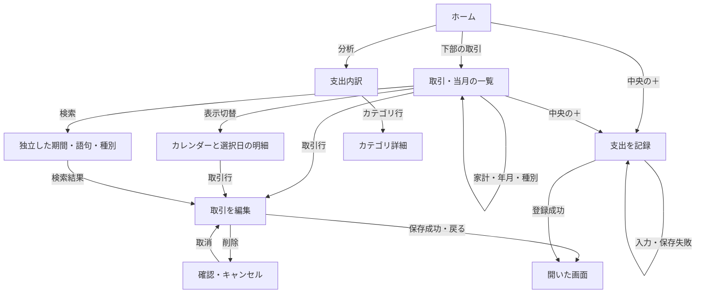

# マネーちゃんの画面監査と操作フロー

2026年11月22日、Expo版の `main` の `daf9d53` を基準に調べた。今回の代表画面は「取引」。同じ月の収支を読む、特定の記録を探す、誤った金額を直す、という異なる目的が一画面で交わる。ここには操作回数を増やさず改善できる表示上の混同と、データ件数に比例する描画処理が両方ある。[監査時点のソース](https://github.com/disnana/DisnanaMoneyManagement/tree/daf9d53/apps/mobile/src)

## 現行の構成

| 対象 | 確認した内容 | 設計への影響 |
| --- | --- | --- |
| モバイルの依存 | ロックファイルで Expo 58.0.26、React Native 0.88.1、React 19.3.0、Expo Router 58.0.32、Expo UI 58.0.29、Reanimated 4.7.1、Gesture Handler 3.3.0、Screens 4.30.1、SQLite 58.0.18。FlashList はモバイルの直接依存にない | インストール済みのRNのリスト、OS別テーマ、ルーターを使った変更を先に評価できる。[ロックファイル](../../apps/mobile/bun.lock) |
| 画面とナビ | `src/app` の TSX は35ファイル。27画面、ルートのホームへのリダイレクト1、レイアウト7。下部には4つの目的地と中央の記録ボタン。各タブがスタックを持ち、編集・検索・計画などは上位のスタックで開く | 中央の＋で直ちに支出を入力。戻る先・画面内の月送り・タブを押したときだけ発生する月リセットは個別に試験する。[タブ](https://github.com/disnana/DisnanaMoneyManagement/blob/daf9d53/apps/mobile/src/app/%28tabs%29/_layout.tsx) |
| 表示 | OS別の `theme.ts` / `theme.ios.ts`、RNのテキストとタッチ操作、Expo Symbols、チャートのSVG、OS別ヘッダーとキーボード対応。明暗・振動・モーションの設定がある。`@expo/ui` は依存済みだが基準版の `src` に直接の import は見つからない | 同じ機能名、金額の読み順、保存規則を共有する。戻る・アイコン・余白には既存のOS差を活かす。[Androidテーマ](../../apps/mobile/src/lib/theme.ts)・[iOSテーマ](../../apps/mobile/src/lib/theme.ios.ts) |
| 初期値と保存 | 取引0件、残高0円の現金・銀行口座から開始。ネイティブの家計データはSQLite、Expo WebプレビューはIndexedDB。モバイルのサインイン行は説明表示。Androidの自動バックアップは専用ビルドの任意機能 | ローカルの読み書きとOSバックアップを区別。データベースに日付・口座などの索引があっても、起動時に取引一覧を読み、表示側が配列から月を選ぶ。スクロール成績をSQLページングの効果とは呼べない。[ストア](../../apps/mobile/src/lib/store.tsx)・[データベース](../../packages/core/src/store/financeDatabase.ts) |
| 既存資産 | 初回ガイドは4画面に各ライト/ダーク画像。マネーちゃんの3柄×2背景・ランチャー用素材、起動画像がある。個人のレシート画像は試験資産に不要 | ガイドは「タイトル→画面例→説明」。画像が見えなくても説明で操作を完了できる。「中央＋」を示すガイドと操作の意味を揃える。[ガイド](../../apps/mobile/src/ui/GettingStarted.tsx)・[既存アセット](../../apps/mobile/assets) |
| 回帰試験 | Vitest は共有コア13ファイルとモバイル設定1ファイルを対象にする。口座残高・手数料・日計・CSV・旧データの移行・書込失敗・表示設定を含む。Playwrightの7 specはVite版に対するもの。モバイルCIは型検査と両OS用Hermes書き出し。別ワークフローにAndroid release APKとオンデマンドiOSビルドがある | 会計の期待値、モバイルでの実操作、描画性能を別々に記録する。`bun run lint`（ルート）はTypeScript検査、モバイルの `expo lint` は別コマンド。[CI](../../.github/workflows/ci.yml)・[E2E構成](../../playwright.config.ts)・[単体テスト設定](../../vitest.config.ts) |

## 画面別の所見

以下は基準版のソースと合成データに基づく。画面に記載した改善候補には本ブランチの代表画面以外の後続候補も含む。具体的な端末・画面幅・テーマ・撮影結果は[Android比較記録](android-validation.md)で扱う。

| 画面・目的 | 使い続けたい点 | 観測できる問題・影響 | 改善案と判定方法 |
| --- | --- | --- | --- |
| 初回・ロック・読み込み・復旧 | 空データのみガイドが自動表示される。スキップでき、設定から開き直せる。読込失敗時は再読込・バックアップ復元、ロック解除失敗時は再試行が可能 | ガイドは実際の画面を写した固定画像。取引の入口を動かすと画像と挙動が食い違う。ロックカバーは家計画面の上に描画され、背面の読上げ可否は端末検証が要る | 初回/既存データ/ロック有りの起動を分ける。読込中・ロック中に取引情報をフォーカスできないか確認。[ガイド](../../apps/mobile/src/ui/GettingStarted.tsx)・[ロック](../../apps/mobile/src/ui/LockGate.tsx)・[読み込みと復旧](../../apps/mobile/src/ui/FinanceRecovery.tsx) |
| ホーム | 総資産の非表示設定が永続化される。現在の総資産、月の収支、口座、カード支払、最近の取引6件。最新の取引を直接編集できる | 「現在」と「選択月」の指標が同居し、最近の取引より先に口座・カードが伸びる。ホームの口座残高プレビューは4件＋展開、カードは件数分伸びる | 現在/選択月のラベルを保ち、カードの多い家計で最新行までの距離を数える。予算はホーム右上から1タップで開ける。[ホーム](https://github.com/disnana/DisnanaMoneyManagement/blob/daf9d53/apps/mobile/src/app/%28tabs%29/home/index.tsx) |
| 取引・日別一覧 | 月送り、家計グループ、種別、検索、カレンダー、日計と明細、ポイント/メモ、長押しメニューが揃う。全体月計と日計は共有ロジックを使う | 冒頭のグループ「すべて」と種別「すべて」の用途が文字から区別しづらい。種別を支出にしても直下の月収支3値は変わらず、その下の日計は変わる。日ごとの枠＋帯＋区切りが繰り返される。アクティブ月は日と行を二重に `map` し、月の全行が同じ縦スクロールの子になる | 月・家計の範囲と「種別で絞る明細」の境界を見出し・順序・余白で示す。日計を日付の近くに置き、明細だけを可変行高で仮想化。ポイント・振替・立替がある合成データで確かめる。[旧取引一覧](https://github.com/disnana/DisnanaMoneyManagement/blob/daf9d53/apps/mobile/src/app/%28tabs%29/transactions/index.tsx)・[旧日別表示](https://github.com/disnana/DisnanaMoneyManagement/blob/daf9d53/apps/mobile/src/ui/TxGroups.tsx) |
| 取引・カレンダー、検索 | カレンダーの日を選ぶとその日の明細へ。検索は6期間、内容・メモ・カテゴリ・口座名、種別・家計グループに対応。結果はすでにSectionList、逆転日付は明示エラー | 一覧で選んだ種別はカレンダーには適用されない。カレンダーのセルには日付と件数のラベルがあるが、表示中の3種の金額はそのラベルから分からない。検索は「全期間」で開き、履歴に表示されていた月と独立する | 一覧/カレンダーを往復して対象と選択状態を見比べる。期間を示したまま、全期間の空、絞込0件、逆転日付を別メッセージで扱う。[カレンダー](../../apps/mobile/src/ui/TransactionCalendar.tsx)・[検索](../../apps/mobile/src/app/search.tsx) |
| 取引追加・編集 | 追加は既定で支出、日付・カテゴリ・口座は初期選択。通常保存、続けて登録、ポイント充当、カード支払、立替、事業経費の按分がある。保存中の二重送信防止・Androidのキーボード避け・削除確認を備える | 金額入力の `replace(/[^0-9]/g, '')` は全角数字を落とす一方、ポイント欄はNFKCで受け付ける。未保存のフォームを戻る際、変更破棄の確認は見当たらない | OSの数字キーボードだけでなく日本語貼付けを試す。編集を破棄したとき旧値、保存成功時だけ新値。ラベル・フォーム・保存経路を履歴から再実装しない。[記録画面](../../apps/mobile/src/app/add.tsx)・[保存ガード](../../apps/mobile/src/lib/useFinanceSubmit.ts) |
| 分析・カテゴリ詳細 | 支出/収入それぞれの内訳・推移、割合と金額・カテゴリ名が併記され、グラフと数値で確認できる。12か月推移には金額表もある | 現行のカテゴリ詳細は `categoryId` の一致で全額合算。内訳は立替を除き、振替手数料を仮想カテゴリに割り当てる。食費等の内訳と詳細、手数料内訳と詳細の行数に差が出る | 共有コアの意味に合わせた詳細条件を独立した修正で検討。以下の5件で再現。支出・収入・手数料と家計切替を試験する。[内訳](https://github.com/disnana/DisnanaMoneyManagement/blob/daf9d53/apps/mobile/src/app/%28tabs%29/analytics/index.tsx)・[詳細](https://github.com/disnana/DisnanaMoneyManagement/blob/daf9d53/apps/mobile/src/app/%28tabs%29/analytics/category.tsx) |
| 口座一覧、口座/カード設定・明細、確定請求額 | 口座とカードを別見出しで同じ画面に並べる。並べ替えの取消、カードの見込み/確定/支済み・残額・ポイント充当、デビットの引落先がある。使用中口座の削除には制限がある | ホームの総資産、口座一覧の合計（カード除く）、カード支払残額は別の数値。詳細の取引は表示月の件数分描画される | 金額に「現在」「選択月」「残額」を添えたまま更新。支払済み・ポイント全額・口座未設定を試し、口座履歴の仮想化は別段階で行う。[口座一覧](https://github.com/disnana/DisnanaMoneyManagement/blob/daf9d53/apps/mobile/src/app/%28tabs%29/accounts/index.tsx)・[クレジット支払い](../../apps/mobile/src/ui/CreditPaymentCard.tsx) |
| 予算・貯金・買い物試算 | ホーム右上の計画内に3種の切替。予算残額/超過、目標と積立、購入候補を予定・購入済みへ進められる。貯金は目的地の中に収まる | 月が影響する予算・買い物と、期限に基づく貯金で時間軸が異なる。購入候補ごとに試算・予定化・編集・削除が並び、候補の数だけ操作が増える | 月選択を貯金に持ち込まない。後続試作では「試算を見る」を主操作にし、副操作を詳細に寄せた場合のタップ差を比較する。[計画](../../apps/mobile/src/app/planning.tsx)・[積立](../../apps/mobile/src/app/planning/savings-editor.tsx)・[買い物試算](../../apps/mobile/src/app/purchase-compare.tsx) |
| 設定、家計グループ、カテゴリ、立替、税務 | 口座右上が設定への入口。外観・操作・事業/精算・情報を用途で束ねる。カテゴリの復元、グループ削除時の移動先、分類別経費・年次CSVを備える | カテゴリ設定の「削除」は入力候補の非表示/復元、取引削除は記録の削除という違いがある。「サインイン」は現時点で遷移のない行。税務の共有が使えない場合、書き出し先が操作側で分からない | 確認文に「何が消える/移るか」を含め、対象による結果を明示。年間/選択月を混ぜない。設定のガイド再表示・Android専用アイコン設定の利用条件を保持。[設定](../../apps/mobile/src/app/settings/index.tsx)・[カテゴリ詳細](../../apps/mobile/src/app/category-detail.tsx)・[税務](../../apps/mobile/src/app/settings/tax.tsx) |
| データ管理・バックアップ | Monemy CSV は口座選択、件数・収支・期間・候補3件・重複プレビュー、確定/取消。JSONは端末へ共有・確認後に全体復元。サンプル置換と初期化は確認を挟む | 設定一覧の「初期化・サンプルデータ」という説明にはCSV/バックアップを含まない。銀行・カード各社のファイル形式は監査したmainの選択肢にない。自動バックアップの可否は専用Androidビルドで変わる | 後続の設定改修で名前に「取込・バックアップ」を含める。未知形式や重複と「成功0件」を分ける。人の実データを試験・画像に使わない。[データ管理](../../apps/mobile/src/app/settings/data.tsx)・[CSV](../../apps/mobile/src/ui/MonemyImport.tsx) |
| レシート撮影・OCR | 現行の支出入力は日付・金額・口座・カテゴリの編集部品を再利用できる | Expoのルート、ソース、依存にはレシート撮影/解析API・クレジット管理がない。`receiptMethod` は収入の受取方法 | 取込の入口、進捗、課金結果を現行版に表示しない。下記の将来フローを検討する際に、権限・機内モード・再送時の重複・原本と推定値の区別を先に決める。[取引型](../../packages/core/src/types/finance.ts)・[モバイル依存](../../apps/mobile/package.json) |

## タップ数と戻り先

タップ数は画面を読める状態から開始し、表に書いたボタン・入力フォーカスのタップを数えた設計値。数字キー入力・縦スクロール・OSファイル選択の操作を別扱いにする。所要時間や利用者テストの結果ではない。

| 操作 | 起点・成立条件 | 現行のタップ | 取消・完了・失敗時 |
| --- | --- | --- | --- |
| 支出を1件登録 | どれかの下部タブ、今日・既定口座・カテゴリで可 | 中央＋ → 金額欄 → 数字を入力 → 右上チェックまたは下の登録、計3。収入を選ぶ場合は1追加 | 通常保存は開いた画面へ。直接リンクは取引一覧へ。保存済みの取引の月を選び、種別が合わなければ「すべて」、単独家計選択中なら記録した家計にする。金額/口座/ポイントのエラーではフォームに留まる |
| 編集・削除 | 月・絞込の条件内に該当行がある | 行 → 金額欄 → 右上保存が3。削除は行 → ごみ箱 → 削除の3。長押し経由は長押し → 削除 → 確認 | 保存前に戻れば記録は元のまま。削除確認はキャンセル・背景・Android Backで閉じる。書込失敗は警告し、削除済み扱いで閉じない |
| 月・家計・種別を変える | 取引一覧 | 前月/翌月は1、横スワイプは1ジェスチャ。月選択→同一年の月→適用は3。家計グループ選択→家計名は2。種別は1 | 月ダイアログは適用まで確定しない。家計選択の閉じる/背景/Backは変更なし。別タブのボタンを押したときは当月に戻す。フォームから単に戻る際はタブリセットと区別 |
| 月内の特定日の取引 | 取引の一覧表示中 | カレンダー → 日 → 行、計3で編集 | カレンダーの選択日はその月で扱う。選択した日の全種類が対象。一覧に切り替えれば元の種別条件を使う |
| 検索・編集 | 取引一覧から先月の買い物を検索 | 虫眼鏡 → 期間 → 先月 → キーワード欄 → 一致した行、計5。期間のみで探す場合は入力欄が不要 | 初期の全期間・全種類・空語句では条件入力をうながす。期間指定の開始日＞終了日は文言を出す。編集からBackは検索スタックが残る。検索画面を閉じるとローカルの条件は破棄 |
| 分析・計画 | ホームから支出内訳の行をたどる | 分析 → カテゴリ行、計2でカテゴリ詳細。収入なら「収入内訳」が加わる。ホーム右上「予算・計画」→「貯金」で目標一覧は2 | 詳細からスタックで戻る。カテゴリの並べ替えはセッション内で「元に戻す」が可能。貯金を独立した下部目的地とするタップは不要 |
| カード支払いを記録 | 口座タブで残額のあるクレジットカード・有効な引落口座を用意 | カード行 →「支払いを記録」→ 登録の3。ポイントがあれば充当欄をタップして追加 | 支払対象月を渡した振替。充当前の請求額、充当額、現金の出金を別々に読み、誤入力時は修正して再試行 |
| CSVの取込・取消 | データ管理から対応形式を選択 | CSV取込 → OSでファイル選択 → 取り込み先の口座 →「この口座に追加する」。アプリ内3、OS操作は別 | 確定前に取消。重複や検証失敗を確認できる。JSONの全体復元とは別の操作 |
| レシート取込（将来の設計） | 現行の実操作は0経路 | 仮に支出フォームからなら、取込元 → 撮影/選択 → 画像確定 → 結果を修正 → 合計/商品別の保存方法 → 確定。手入力の3タップは増やさない | 権限拒否時は手入力へ、失敗時は再試行/取消、部分認識は要確認箇所にフォーカス。保存成功後に対象月の取引を開けることを実装の条件とする |

## 会計表示を壊さないための小さな事例

この節では立替を含む会計境界の専用例を使う。画面撮影に使う次表の共通データとは別に、同じ日に同一の家計に5件を置く。食費1,000円のうち250円をポイントで支払い、食費カテゴリで300円を立て替え、300円を回収する。別途振替5,000円に手数料110円、収入2,000円とする。実際の `computeMonthCashFlow`、`groupTransactionsByDate`、`getEffectiveOutflow` と基準版詳細の抽出式を隔離したNodeプロセスで実行した。

| 見ている箇所 | 値 | この値に達する理由 |
| --- | ---: | --- |
| 月間の収入 / 支出 / 収支 | 2,000 / 1,110 / +890円 | 立替と回収は家計の損益から除く。振替は手数料110円だけが支出 |
| 「支出」の明細件数 / 日計 | 2件 / −1,000円 | 立替行も履歴には残る。種別「支出」は振替行を除く |
| 食費1,000円の実支払額 | 750円 | ポイント充当額は口座からの流出を減らす。購入額そのものとは別の値 |
| 基準版での分析「食費」内訳 / その詳細 | 1,000 / 1,300円 | 詳細の単純和に立替300円が入る |
| 基準版での「振替・振込手数料」内訳 / その詳細 | 110円 / 0件 | 手数料を持つ取引の実カテゴリは `transfer`、集計の表示カテゴリは `transfer_fee` |

後ろ2行は分析側の既存差異。履歴改修でグループ、日付、種別や会計関数を変更すると、表示上は整ってもこの関係を壊しやすい。[会計集計](../../packages/core/src/utils/metrics.ts)・[費用と立替の判定](../../packages/core/src/utils/advances.ts)・[金額書式](../../packages/core/src/utils/format.ts)

## 比較用の共通データに対する期待値

撮影・件数試験で使う共通データを、`getMonthTransactions` → `groupTransactionsByDate` と `computeMonthCashFlow` に通した結果。金額は円、期間は2026年11月。1件目の1,280円に200ポイント充当した実支払額は1,080円。全種別の日計の総和は各行の月間収支と一致した。これは計算値の照合で、時間やFPSの測定結果は含まない。[比較用データ生成](history-fixture.mjs)

| 全件数 | 日付見出し数 | 月間収入 | 月間支出 | 月間収支 | 支出フィルタ件数 | 支出フィルタの日計の和 |
| ---: | ---: | ---: | ---: | ---: | ---: | ---: |
| 0 | 0 | 0 | 0 | 0 | 0 | 0 |
| 5 | 3 | 268,000 | 5,680 | +262,320 | 3 | −5,570 |
| 50 | 22 | 268,000 | 42,750 | +225,250 | 48 | −42,640 |
| 1,000 | 22 | 268,000 | 839,470 | −571,470 | 998 | −839,360 |
| 10,000 | 22 | 268,000 | 8,376,970 | −8,108,970 | 9,998 | −8,376,860 |

## 代表画面の実装前に決めた受け入れ手順

1. **対象月と明細の対象を読み分ける。** 基準版と候補版を同じ端末設定・月・架空データで起動。スクリーンリーダーの先頭から、年月、家計、月の金額、明細条件、日付、取引の順を確認する。支出のみで月の収入が変わらず、日計・件数が合うかを上の事例で確認する。
2. **縦スクロールの持ち主を一つにする。** 選択月だけを可変行高の仮想リストにし、月の横スワイプ・矢印・年月ダイアログでも月が一度だけ切り替わるかを確認。画面外の隣月はタッチや読上げのフォーカスを受けない。先頭・中央・最終日の同じIDを往復して編集し、別の取引を誤って開かないこと。
3. **空と絞込0件を区別する。** 新規端末、空の月、家計/種別の組み合わせに該当がない場合を用意。月を変える・絞込を戻す・記録する操作が分かるかを確かめる。DBの読込失敗はグローバルな復旧画面、書込失敗はフォームに残る既存の警告で確認する。オフラインではローカル取引を使用する。
4. **操作領域と文字拡大を測る。** 360dpと通常幅、可能なら600dp以上で、日付・長い日本語名・多桁の金額・ポイント説明・メモを確認。種別の選択状態、日見出し、編集ボタン、選択を閉じる手段をアクセシビリティツリーで確かめる。読み上げ音声・ジェスチャー操作はTalkBack/VoiceOverの実端末で別途試す。端末のテーマとアプリのテーマ固定、モーション削減を含める。
5. **性能を同じ操作で比べる。** 0・5・50・1,000・10,000件の架空データで、開く/一定距離スクロール/編集から戻る/月±1を同順序で繰り返す。データ生成・初回インストールと描画時間を別にする。スクリーンサイズ、リフレッシュレート、ビルド種別、CPU/描画アクセラレーション、p50/p95・遅延フレーム・メモリを取得できた範囲で残す。実端末・エミュレーター・ブラウザーの結果はそれぞれ同条件内で対比する。

## 候補版の空表示・保存失敗・オフラインを実操作で確認

2026年11月22日、全プラットフォーム向けに生成した最終候補の Expo Web 静的出力（`entry-c65057b1d62ea8eabb3632c64f184193.js`）をローカルで配信し、Playwright と Chromium 156.0.8078.79 で確認した。393 × 852 CSS px、日本語、東京、ライトテーマで日付を11月22日に固定した。ケースごとに独立した一時プロファイルを開き、架空の0件または5件を通常の旧形式読み込みから IndexedDB に移した。金額は画面表示と保存済みデータを別々に確認した。[架空データ](history-fixture.mjs)・[保存実装](../../packages/core/src/store/browserFinanceStorage.ts)

| 条件 | 実際の操作 | 確認した結果 |
| --- | --- | --- |
| 今月に取引0件 | 履歴で0円と下部の＋への案内を確認し、＋から登録画面を開く。戻って前月に移動し「今月に戻る」を押す | 11月の0件と10月の0件を月名で区別できた。11月に戻り、保存件数は0件のまま |
| 条件に合う明細0件 | 収入だけを取り除いた4件で「収入」を選び、「すべての取引を表示」を押す。次に取引のない「事業」を選び「全グループを表示」を押す | それぞれの操作で青葉ベーカリーの行が再表示された。別のタブに移る必要はなかった |
| 読み込み待ち | 同一テスト用プロファイルの別ページが IndexedDB の書込トランザクションを保持したまま起動。DBを解放 | アクセシビリティツリーに「家計データを読み込み中」が現れ、待機中は0円を表示しなかった。解放後は月の収支 +262,320円 |
| 読み込み失敗からの復帰 | 既存データに対する最初の読込トランザクションを一度中断し、画面の「再読み込み」を押す | 「家計データを開けませんでした」とデータ保持の説明、復元の選択肢が出た。再読込で5件・+262,320円に戻った。保存済み5件の金額とDBリビジョンは失敗前と同じ |
| 編集の保存失敗から再試行 | 青葉ベーカリーを1,280円から1,680円に編集し、保存トランザクションを一度中断。別ページで月の収支を確認後、元のフォームで再度保存 | 保存失敗の警告が出てフォームに1,680円が残った。別ページで5件・+262,320円、DB内で1,280円を確認。再試行後の再読込では5件・+261,920円、同じ取引が1,680円、200ポイント。ほか4件の金額も一致 |
| 開いた編集画面で通信を切る | オンラインで青葉ベーカリーを開き、接続を切って1,380円に編集。保存後に履歴へ戻り、再接続・ページ再読込 | 切断中から5件・+262,220円を表示。再接続・再読込後も1,380円が保存されていた |
| 読込済みの登録画面を切断後に開く | オンラインで＋を一度開いて履歴に戻る。切断後に再び＋から新しい支出460円を登録 | 新しい行1件だけが増え、6件・+261,860円。再接続してページを読み直しても新しい行・合計が一致した |
| その端末でまだ開いていない編集画面に切断後に進む | 新しい一時プロファイルで履歴だけを開き、接続を切って明細を押す | **編集画面を開けなかった。** Expo Web が初回に取得する `add-….js` が `ERR_INTERNET_DISCONNECTED`。2.5秒待った時点で読み上げツリーは空で、画面内の再試行操作を見つけられなかった。再接続後に再読込すると編集画面が開き、保存済み5件を保持 |
| 通信が切れたままブラウザーで再読込 | 履歴が開いた状態で切断し、ページ全体を再読み込み。接続回復後に再度開く | **静的配信のページをオフライン起動できなかった。** 通信回復後は5件・+262,320円と保存済みリビジョンが一致した |

基準版 `daf9d53` にも同じ「初めて開く編集画面」の試験を行った。基準版も分割JSの取得に失敗し、再接続・再読込で復帰した。このオフライン時の制限は両版にある。Webで対応する場合、初回に必要となる画面コードと起動用HTMLの事前取得、通信回復後に画面内で再試行できる導線を検証対象にする。

ネットワーク切断にはブラウザーコンテキストのオフライン機能を使い、`navigator.onLine === false` とキャッシュを使わない同一オリジンへのリクエスト失敗を照合した。読み込み・保存の中断はテストページの IndexedDB トランザクションで発生させた。実機のSQLite・ストレージ枯渇、Android の通信切断・プロセス再起動、バックアップファイルからの書き戻しはこの試験の対象外。[読込・復旧画面](../../apps/mobile/src/ui/FinanceRecovery.tsx)・[ネイティブのSQLite保存](../../apps/mobile/src/lib/financeStorage.ts)
